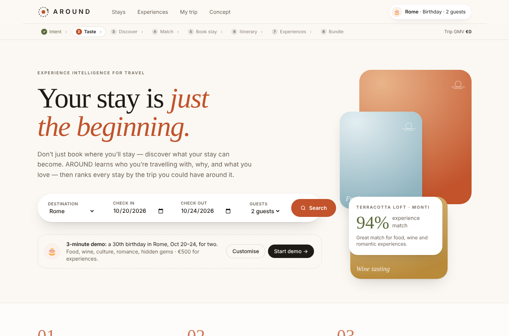
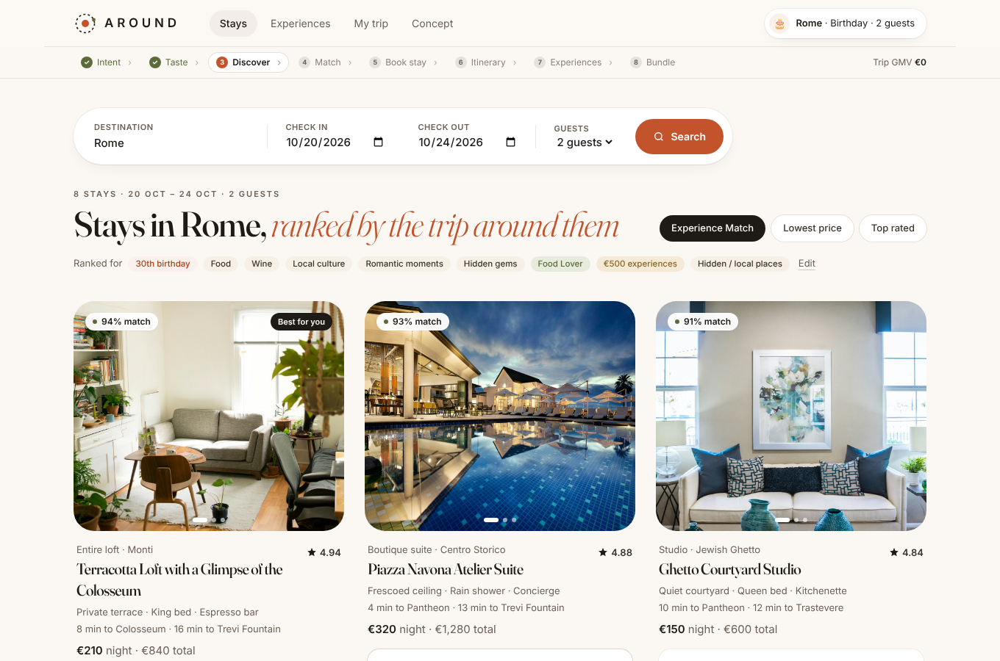
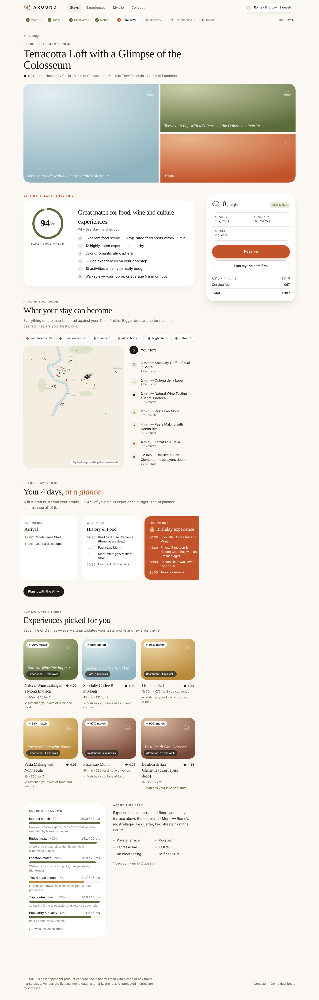
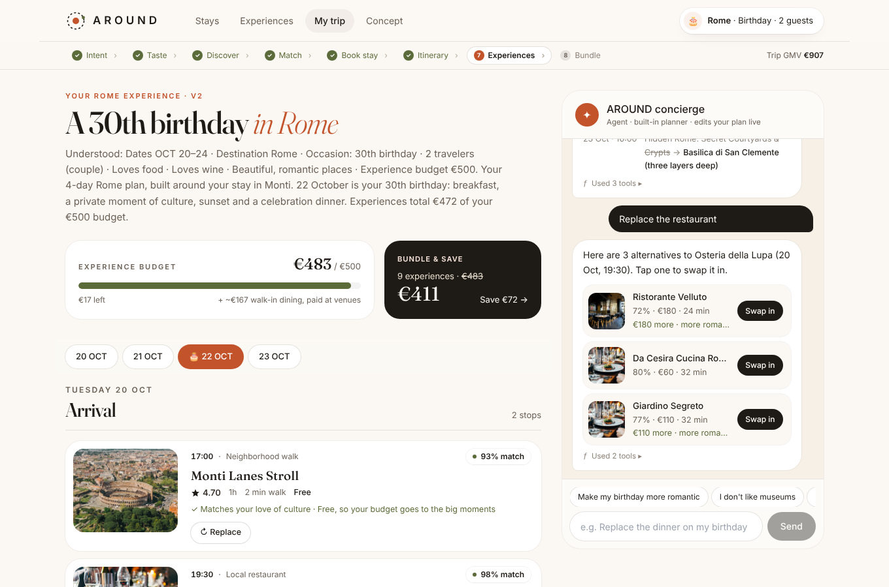
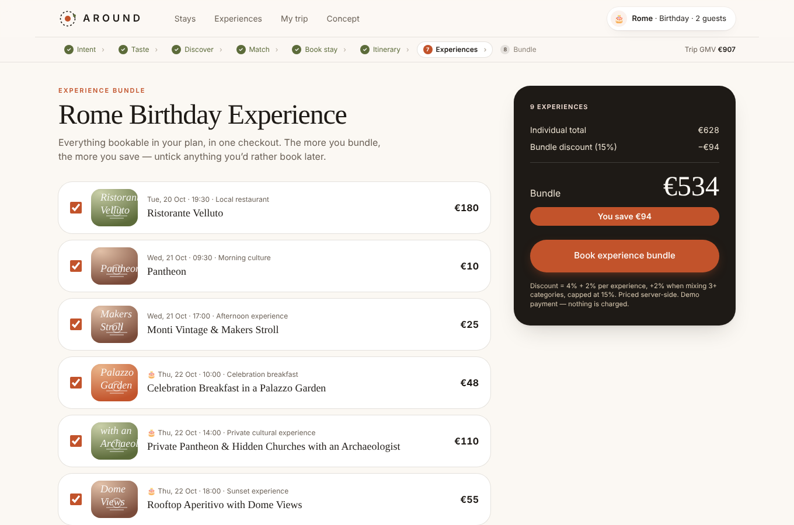
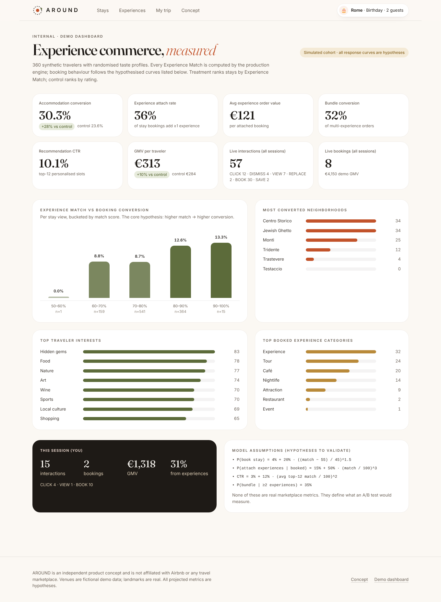

# AROUND

> **Your stay is just the beginning.**
>
> Don't just book where you'll stay — discover what your stay can become.

AROUND is a proof-of-concept **Experience Intelligence & Commerce layer** for travel marketplaces. It turns accommodation discovery into experience discovery: every stay is ranked by the trip a traveler could have around it, an AI agent plans and reshapes the days, and experiences are sold together as a bundle.

> This project is an independent product concept and is not affiliated with Airbnb.
> Venue names are fictional demo data; landmarks are real. All projected metrics are hypotheses.

---

## Product vision

Marketplaces sell rooms. Travelers buy trips. AROUND closes that gap by understanding **who** is travelling, **why**, what they love, their budget, pace and how local they want to go — and scoring every stay by the experiences around it.

**The wow moment (≈ 3 minutes):** pick a stay → instantly see **"94% Experience Match"**, the reasons behind it, a map of what's around the door and a draft of the trip → let the AI build the full itinerary → reshape it by conversation → book it as one bundle.

## Problem

Travelers choose where to stay without fully understanding what they can experience around the accommodation. Listings compete on photos, amenities and price; the trip itself is invisible at the moment of decision.

## Solution

| Layer | What it does |
|---|---|
| **Travel Taste Profile** | 6-question onboarding (trip type, interests, style, budget, pace, discovery style) + learned affinities |
| **Experience Match** | Explainable 0–100 score for every stay and experience, with human-readable reasons and cautions |
| **Stay Experience page** | "Stay here. Experience this." — score, reasons, layered map, walking timeline, trip preview |
| **AI Trip Planner** | Free-text request → structured profile → budget-aware itinerary built around the stay |
| **Agent** | Conversational edits ("make my birthday more romantic", "I don't like museums", "under €400", "more local", "replace the restaurant") with a visible tool trace |
| **Bundles** | Dynamic discount, priced server-side, one checkout |
| **Analytics** | Demo dashboard with a simulated cohort run through the real engine |

## Demo walkthrough

1. **Home** → type any destination (autocomplete; Rome is the live demo city, others show a "coming soon" page) or *Start demo* (persona: 30th birthday in Rome, Oct 20–24, 2 guests, food · wine · culture · romance · hidden gems, €500 for experiences). Or *Customise* to take the quiz.
2. **/stays** → stays sorted by Experience Match (Monti loft = 94%).
3. **/stays/stay-monti-loft** → match ring, reasons, map layers, walking timeline, 4-day preview, nearby experiences (save / like / dismiss), score breakdown. *Reserve* (mock payment).
4. **/trip** → *Build my trip* → itinerary with Book / Replace on every stop; chat with the concierge.
5. **/bundle** → untick items, watch the discount update, *Book experience bundle*.
6. **/experiences** → open, save or dismiss items and watch the **"Your taste, learning"** panel move.
7. **/admin/analytics** (hidden) and **/concept** (pitch).

## Screenshots

| Home | Stays ranked by match | Stay experience page |
|---|---|---|
|  |  |  |
| **Agent editing the plan** | **Bundle checkout** | **Demo dashboard** |
|  |  |  |

*(Screenshots were captured offline, so photos show the built-in gradient fallback. With internet access the app loads Unsplash photography.)*

## Architecture

```
src/
├── app/                      # Next.js App Router: pages + API routes (thin)
│   ├── api/{itinerary,agent,bookings,interactions,analytics,recommendations,catalog}
│   └── stays · experiences · trip · bundle · profile · concept · admin/analytics
├── components/               # design system: ui/, layout/, map/
├── features/                 # UI by domain: accommodations, experiences, recommendations,
│                             #   traveler-profile, itinerary, agent, bundles, analytics
├── domain/                   # pure business logic (no framework, no I/O)
│   ├── types.ts · labels.ts · persona.ts
│   ├── recommendation/       # engine.ts (match, ranking, learning) · weights.ts
│   ├── itinerary/builder.ts  # slot templates, budget optimiser, alternatives, diffs
│   └── bundles/pricing.ts
├── services/                 # application services
│   ├── agent/                # tools.ts · intent.ts (planner) · executor.ts
│   ├── analytics.ts          # simulated cohort + live summary
│   └── context.ts
├── providers/                # external boundaries behind interfaces
│   ├── ai/                   # AIProvider · MockAIProvider · OpenAIProvider
│   ├── maps.ts               # MapsProvider · LocalMapsProvider
│   └── payments.ts           # PaymentProvider · MockPaymentProvider
├── repositories/             # CatalogRepository / EventRepository (memory | prisma)
├── data/rome.ts              # seed catalogue
└── lib/                      # client store (zustand, persisted), API client, formatting
prisma/schema.prisma · prisma/seed.ts
```

**Boundaries:** pages are server components that read from repositories and pass data to client feature components. The domain layer is pure and shared by server and client (stays are re-scored instantly as preferences change). Prices for bookings are always recomputed server-side. State (profile, stay, itinerary, chat, bookings, interactions) persists across pages via `localStorage`.

## Recommendation engine

`src/domain/recommendation/engine.ts` — deterministic, explainable, **no random scores**.

```
score = interest × 0.30 + budget × 0.20 + location × 0.20
      + style × 0.15 + context × 0.10 + quality × 0.05      → normalised 0–100
```

| Component | Experience-level | Stay-level |
|---|---|---|
| Interest | affinity-weighted tag overlap (disliked tags subtract) | 50% interest coverage within 15 min + 50% avg of top-10 picks |
| Budget | price vs daily experience budget | avg over top-10 picks |
| Location | walking minutes (≤6 min = 1.0, decays to 30 min) | 75% top-10 walk + 25% walkability |
| Style | travel-style fit (exact / related) + highlights-vs-local fit | avg over top-10 |
| Context | suitability for trip type, romance bonus for couples | 70% picks + 30% stay vibe |
| Quality | rating × review volume | 50% picks + 50% stay rating |

Every result returns `{ score, breakdown, reasons }` (stays also return `cautions`, `headline` and facts like *"12 highly-rated experiences nearby"*). The UI shows each component's contribution and the full formula.

**Preference learning:** interactions update affinities — `VIEW +0.02 · CLICK +0.06 · SAVE +0.12 · LIKE +0.15 · BOOK +0.20 · REPLACE −0.12 · DISMISS −0.30` (range −1…2). Rankings, stay scores and itineraries react immediately; a toast and the *"Your taste, learning"* panel make it visible.

**Itinerary optimiser** (`domain/itinerary/builder.ts`): day templates (arrival · full day · occasion day · last day, adjusted for pace) define slots; each slot picks the candidate maximising `selection − λ·price/100`, and λ is found by bisection as the smallest price sensitivity that fits the budget. The occasion day is protected (λ × 0.1), so the birthday is the last place the plan economises. Walk-in dining is shown as an estimate and does not consume the experience budget; reservable tables do.

## AI architecture

```ts
interface AIProvider {
  generateItinerary(ctx, request?)   // free text → profile patch → itinerary + narrative
  modifyItinerary(ctx, message)      // conversational edits
  explainRecommendation(exp, match, profile)
}
```

- **MockAIProvider** (default, no keys): a rule-based planner turns messages into `AgentAction[]`.
- **OpenAIProvider** (`AI_PROVIDER=openai`): the LLM produces the same `AgentAction[]` as JSON; falls back to the rule-based planner on any error.
- Either way, actions run through a **deterministic executor** over a toolkit, so results stay explainable and auditable:
  `searchExperiences · rankExperiences · getTravelerProfile · calculateDistance · checkBudget · buildItinerary · replaceExperience · createBundle`.
  Each call is logged and shown in the chat ("Used 3 tools ▸").

## Data model

Prisma schema (`prisma/schema.prisma`): **User, TravelerProfile, Trip, Accommodation, Experience, ExperienceCategory, ExperienceProvider, Recommendation, Interaction, Itinerary, ItineraryItem, Bundle, Booking**, with `InteractionType = VIEW | CLICK | SAVE | DISMISS | BOOK | REPLACE | LIKE`.

Seed data (`src/data/rome.ts`): 8 accommodations, 39 experiences/tours/cafés/walks, 10 restaurants, 5 nightlife venues, 8 cultural attractions — with prices, coordinates, ratings, categories, descriptions, durations, localness, contexts and time-of-day.

## Run locally

Requirements: Node 20.9+ (`.nvmrc` pins 22 — run `nvm use`).

```bash
npm install
npm run dev          # http://localhost:3000
```

That's it — the demo runs fully in memory, with no database, API keys or payments.

Optional PostgreSQL:

```bash
cp .env.example .env         # set DATA_SOURCE=prisma and DATABASE_URL
npm run db:setup             # prisma generate + db push + seed
npm run dev
```

Useful scripts: `npm run build`, `npm run typecheck`, `npm run test:engine` (prints stay scores and reasons for the demo persona), `npx tsx scripts/agent-demo.ts` (runs the full agent conversation in the terminal).

## Environment variables

| Variable | Default | Purpose |
|---|---|---|
| `DATA_SOURCE` | `memory` | `memory` or `prisma` |
| `DATABASE_URL` | — | PostgreSQL connection (only for `prisma`) |
| `AI_PROVIDER` | `mock` | `mock` or `openai` |
| `OPENAI_API_KEY` | — | Required for `openai` |
| `OPENAI_MODEL` | `gpt-4o-mini` | Planner model |
| `PAYMENT_PROVIDER` | `mock` | Payments are always mocked in this MVP |

## Future integrations

- Real inventory & availability APIs behind `CatalogRepository` (experience suppliers, restaurant reservations, event ticketing)
- `MapsProvider` → Mapbox / Google (real routing, transit times, isochrones)
- `PaymentProvider` → Stripe / Adyen with split payouts to experience providers
- LLM function-calling directly against the toolkit; streaming agent responses
- Learned ranking (logistic / GBDT on `Recommendation` + `Interaction` logs) replacing hand-set weights, with the same explanation surface
- Multi-city catalogues, group trips, in-trip re-planning (weather, closures)

## Business hypotheses

The funnel the demo makes visible: **Intent → Preference discovery → Accommodation discovery → Experience Match → Stay booking → Personalised itinerary → Experience booking → Bundle / cross-sell → Higher GMV**.

Hypotheses (not measured facts — each needs an A/B test):

1. Showing Experience Match increases **accommodation conversion**.
2. Discovering experiences while choosing a stay increases **experience attach rate**.
3. A planned itinerary + bundle increases **items per order** and **cross-sell**.
4. Together they raise **GMV per traveler**.
5. A living plan drives **engagement and retention** before and during the trip.
6. Interactions build durable **first-party preference data**.

The dashboard (`/admin/analytics`) runs a 360-traveler simulated cohort through the real engine with explicitly stated response curves (treatment = ranked by match, control = ranked by rating). Its numbers illustrate the measurement plan only.

---

This project is an independent product concept and is not affiliated with Airbnb.
